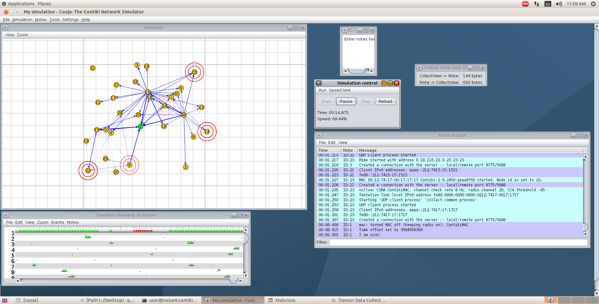
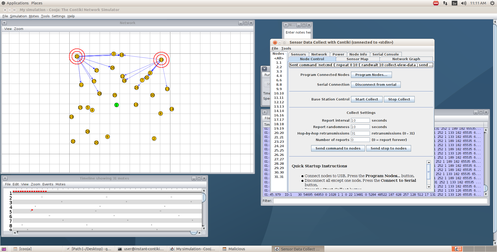
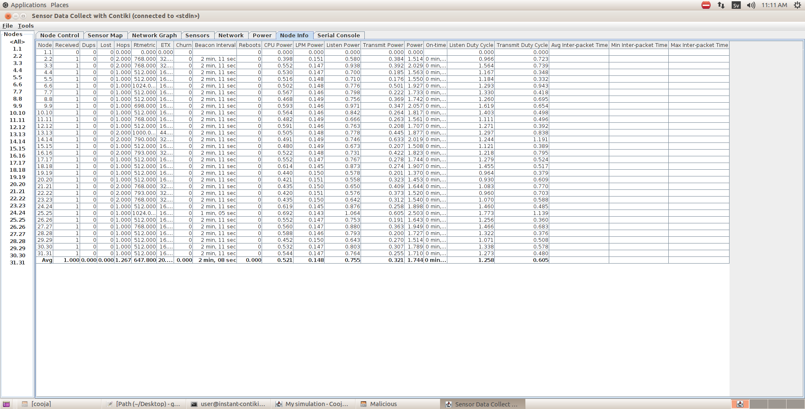
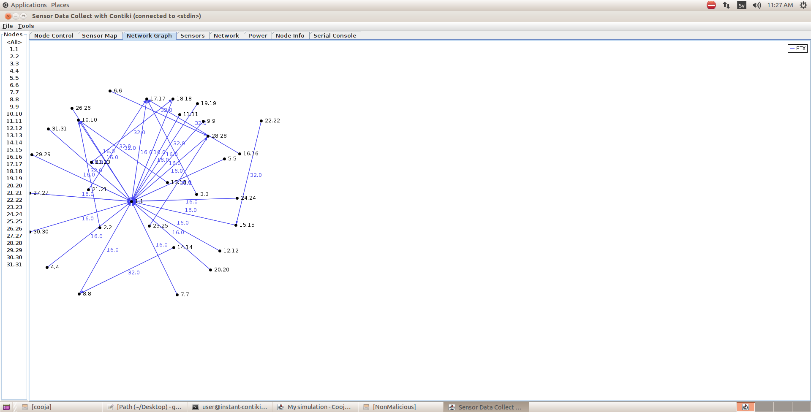
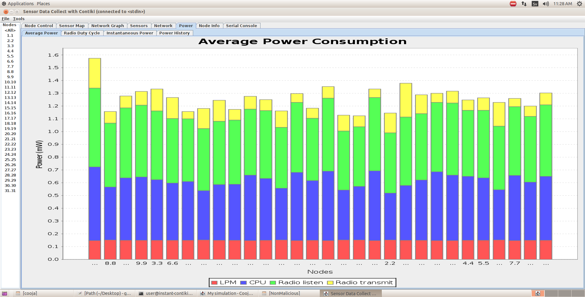
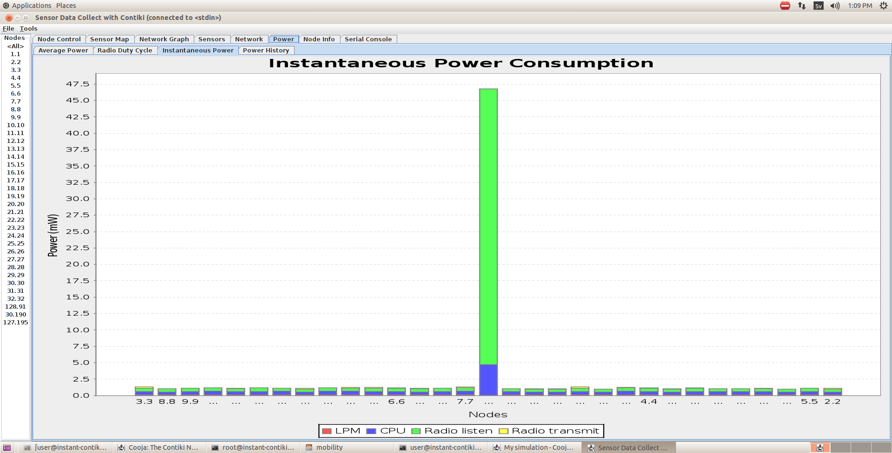
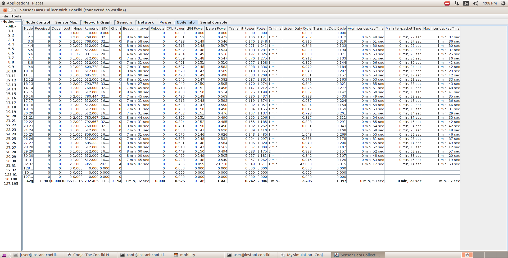
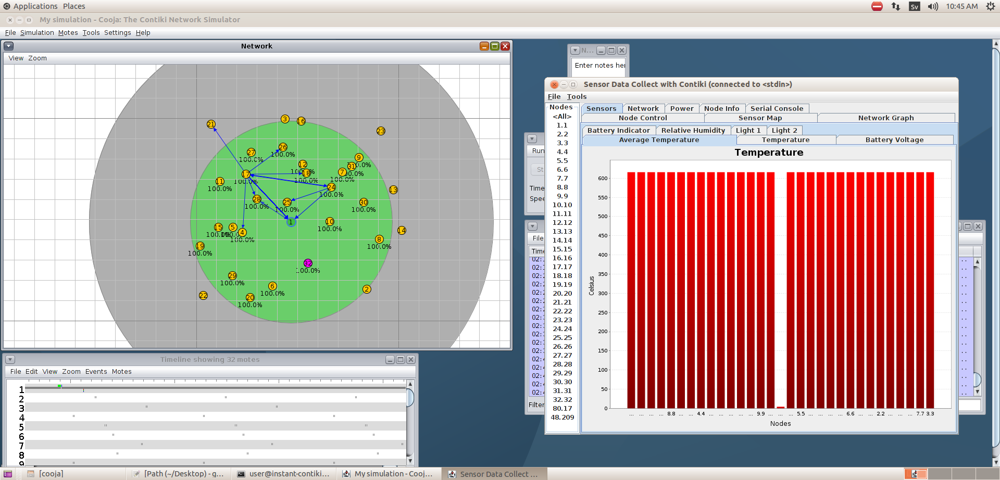
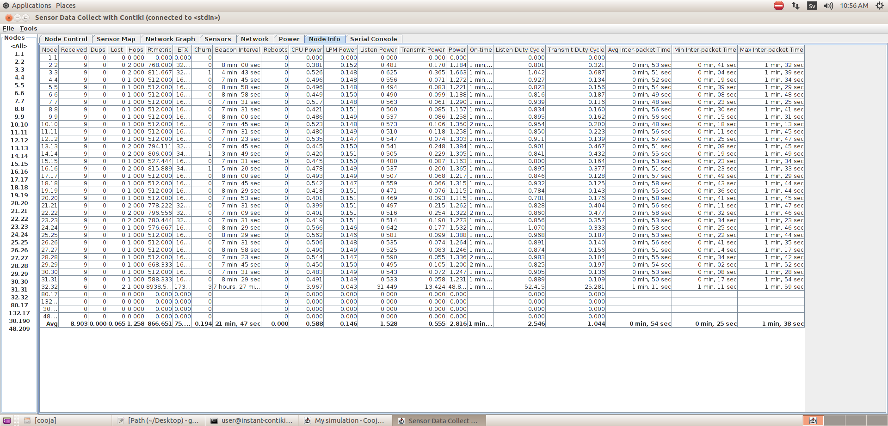
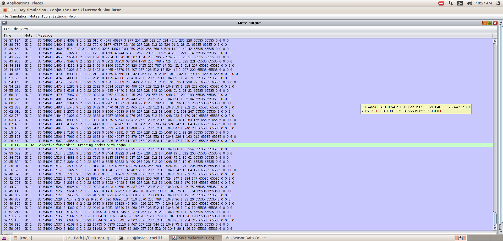

# Simulation Figure Gallery

Original screenshots extracted from Chapter 4 of the supplied project report. Figure numbers retain the original ordering.

[Project overview](../README.md) · [Complete chapter](../docs/project-report.md)

## Figure 4.1 — Normal network operation in Cooja

## Figure 4.2 — Node data collection

## Figure 4.3 — Node information status

## Figure 4.4 — Sensor node connections

## Figure 4.5 — Normal-network average power consumption

## Figure 4.6 — Instantaneous power consumption with one mobile node

## Figure 4.7 — Data collection with one mobile node

## Figure 4.8 — Network operation and temperature with a malicious node

## Figure 4.9 — Node information with a malicious node

## Figure 4.10 — Output identified in the report as showing the sixth packet dropped

## Interpreting the power figures

Figure 4.5 shows average power consumption, while Figure 4.6 shows instantaneous power with one mobile node. These different views alone do not provide a controlled quantitative comparison or establish that a power spike was caused by an attack.
